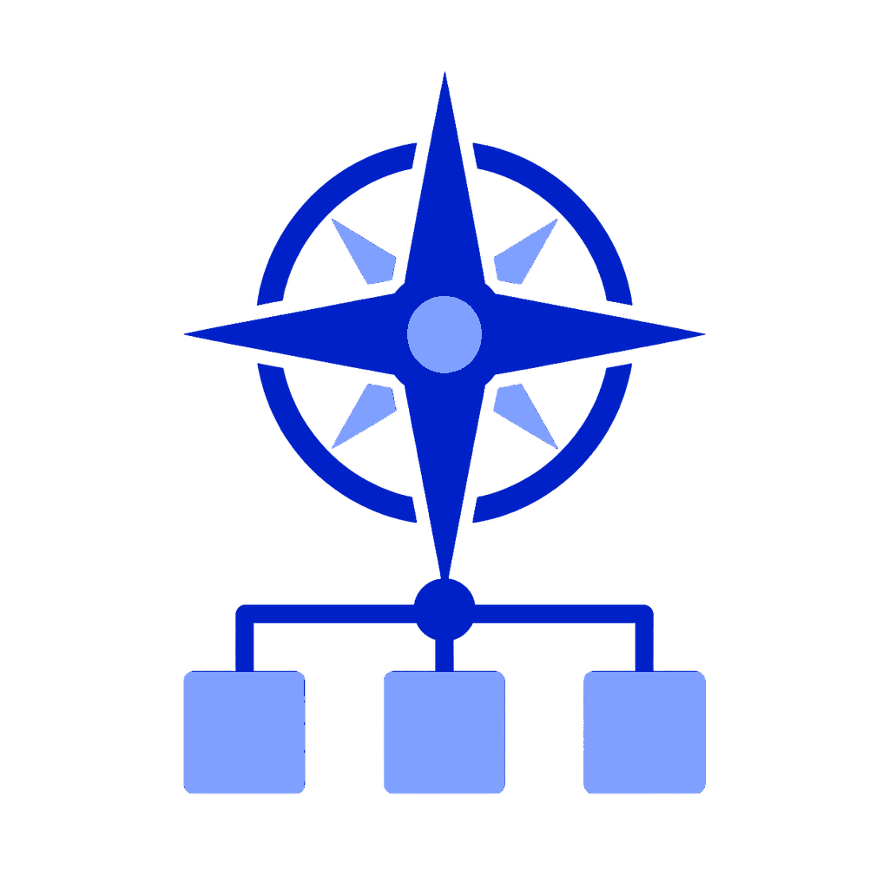
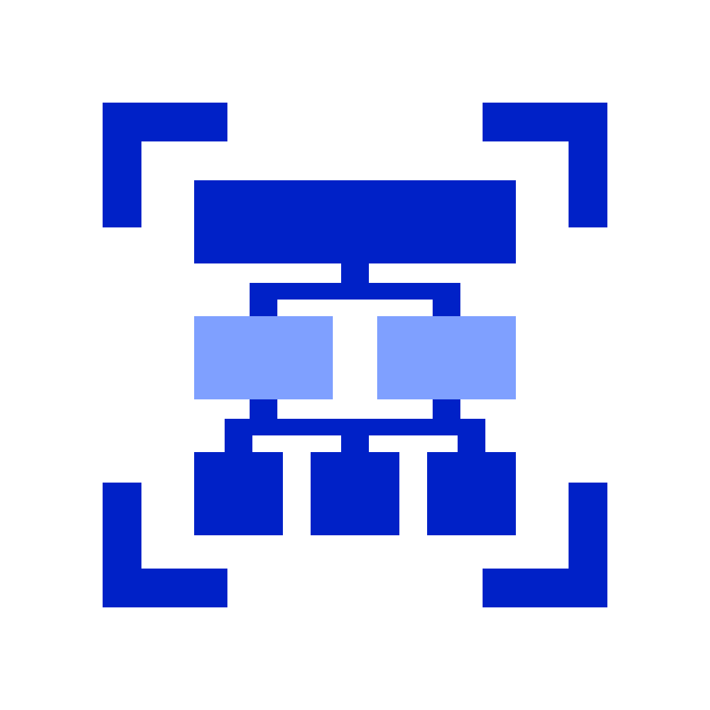
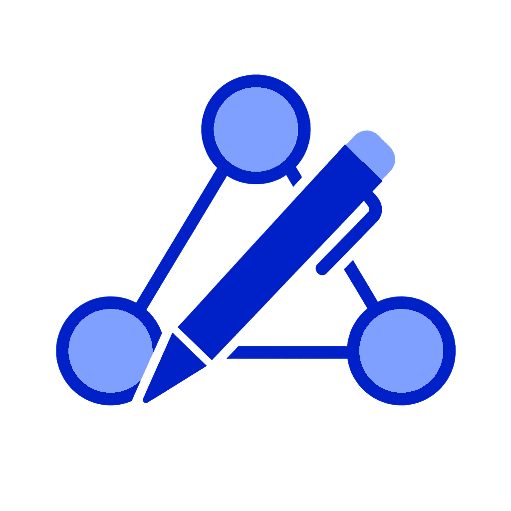
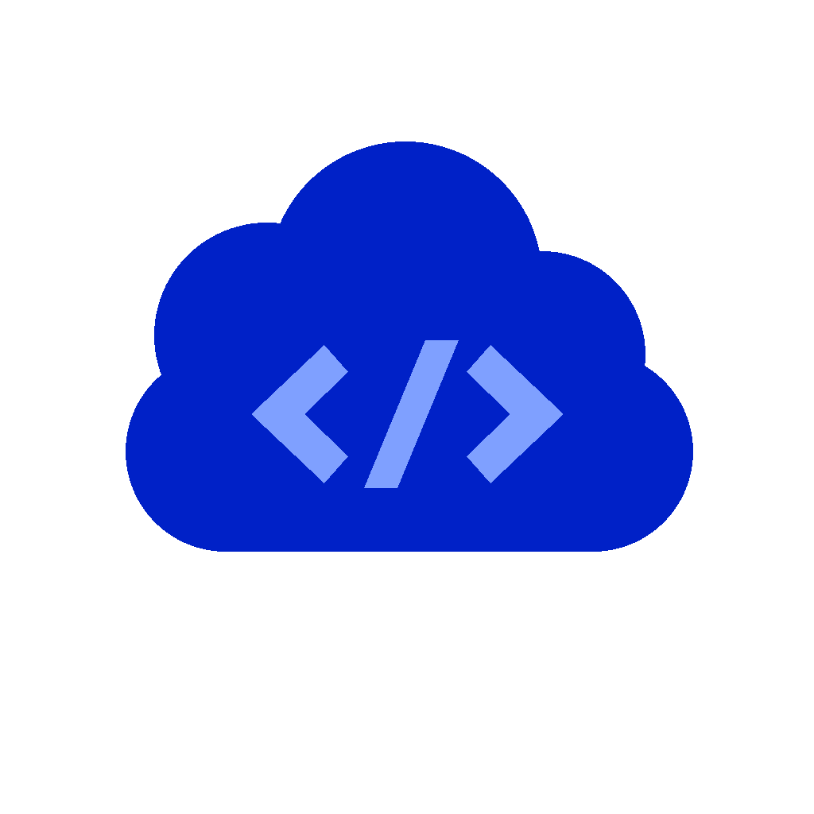

<p align="center">
  <picture>
    <source
      srcset="docs/assets/stark-ai-de-agent-skills-logo-static.svg"
      media="(prefers-reduced-motion: reduce)"
    />
    <source
      srcset="docs/assets/stark-ai-de-agent-skills-logo-animated.gif"
      type="image/gif"
    />
    
  </picture>
</p>

<h1 align="center">Agent Skills</h1>

<p align="center">
  Reviewed workflows for Codex, Cursor, Claude Code, and portable engineering tasks.
  <br />
  <a href="https://stark-ai-de.github.io/agent-skills/">Browse the catalog</a>
  ·
  <a href="https://chatgpt.com/plugins/plugins_6a85d98a7bc48191879aedd91610271e">
    Open the ChatGPT plugin
  </a>
  ·
  <a href="skills/README.md">Explore public skills</a>
  ·
  <a href="CONTRIBUTING.md">Contribute</a>
</p>

<p align="center">
  <a href="https://chatgpt.com/plugins/plugins_6a85d98a7bc48191879aedd91610271e">
    
  </a>
  <a href="https://www.skills.sh/stark-ai-de/agent-skills">
    
  </a>
</p>

<p align="center">
  <a href="https://github.com/stark-ai-de/agent-skills/releases">
    
  </a>
  <a href="https://github.com/stark-ai-de/agent-skills/actions/workflows/validate.yml">
    
  </a>
  <a href="https://github.com/stark-ai-de/agent-skills/actions/workflows/pages.yml">
    
  </a>
  <a href="LICENSE">
    
  </a>
</p>

Public skills are reviewed before promotion. Draft and experimental workflows stay in the incubator until they have enough evaluation proof and a clear maintenance path.

## Quick start

List the public catalog without installing anything:

```bash
npx skills@latest add stark-ai-de/agent-skills --list
```

Install one skill into the agent detected for the current project:

```bash
npx skills@latest add stark-ai-de/agent-skills --skill architecture-compass
```

Update installed skills:

```bash
npx skills@latest update
```

<details>
<summary><strong>Install the Codex bundle</strong></summary>

```bash
npx skills@latest add stark-ai-de/agent-skills --skill codex-memory-curator codex-spec-interviewer animated-readme-logo architecture-compass architecture-zoom codegraph-ast-grep drawio-diagrams telegram-serverless karakeep-knowledge jev-capability-advisor visual-reports -g -a codex -y
```

Install the portable plugin with Codex CLI 0.147.0 or later:

```bash
codex plugin marketplace add stark-ai-de/agent-skills
codex plugin add stark-ai-developer@stark-ai-developer-local
```

See the [plugin documentation](plugins/README.md) for package and distribution details.

</details>

<details>
<summary><strong>Install the Cursor bundle</strong></summary>

```bash
npx skills@latest add stark-ai-de/agent-skills --skill cursor-memory-curator cursor-spec-interviewer animated-readme-logo architecture-compass architecture-zoom codegraph-ast-grep drawio-diagrams telegram-serverless karakeep-knowledge jev-capability-advisor visual-reports -g -a cursor -y
```

</details>

<details>
<summary><strong>Install the Claude Code bundle</strong></summary>

```bash
npx skills@latest add stark-ai-de/agent-skills --skill claude-memory-curator claude-spec-interviewer animated-readme-logo architecture-compass architecture-zoom codegraph-ast-grep drawio-diagrams telegram-serverless karakeep-knowledge jev-capability-advisor visual-reports -g -a claude-code -y
```

</details>

Bundles use explicit, version-controlled manifests. The Codex bundle is the ordered skill allowlist in [`plugins/stark-ai-developer.source.json`](plugins/stark-ai-developer.source.json), and its install command below is checked against that manifest. The bundles install globally; remove `-g` for a project-local install. Avoid `--skill '*'` when targeting one runtime because it also selects skills built specifically for other runtimes.

The `-a` option selects the host where a skill is installed; it does not change that skill's target contract. An intentionally cross-host install preserves target-specific evidence and output while adapting collaboration controls to the selected host.

## Local SSH management

The portable local plugin includes the standalone SSH runtime from
[stark-ai-de/ssh-manager](https://github.com/stark-ai-de/ssh-manager), the canonical
owner of `@stark-ai/ssh-manager`, its local API/runtime and MCP adapter. Node 24.18
or newer is required. This repository consumes a reviewed, revision- and
digest-pinned artifact; normal plugin generation requires no producer checkout or
network. The public OpenAI archive remains skills-only.

```bash
pnpm install --frozen-lockfile
pnpm run validate:ssh
pnpm run sync:agent-plugin
node plugins/stark-ai-developer/runtime/cli.mjs help
node plugins/stark-ai-developer/runtime/cli.mjs start
```

Producer source, library examples and native SSH/browser fixtures belong to the
[SSH repository](https://github.com/stark-ai-de/ssh-manager). To update the bundled
runtime, review the producer revision and artifact manifest digest, then run
`node scripts/ssh/import-artifact.mjs <runtime-directory> <reviewed-pin.json>`.
The pin JSON contains `version`, `sourceRepository`, `sourceCommit` and
`manifestSha256`; import verifies the entire payload before replacing it.
Regenerate projections and run the consumer validation after importing.

In an installed portable or Claude package, use `node runtime/cli.mjs` instead.
The MCP starts this same daemon on demand. Setup requires a trusted local operator:
create a profile, assign an existing SSH-agent socket, private-key file reference or
encrypted vault credential, inspect and confirm its exact host fingerprint, then
grant capabilities at the current profile revision. `operator <operation> <JSON-file>`
accepts structured setup arguments and prompts for explicit confirmation. Vault
initialization, unlock and rotation prompt without echoing the password. No key is
generated, provisioned or silently trusted; existing `known_hosts` is only read.

Example profile arguments for `ssh_host_create`:

```json
{
  "profile": {
    "name": "example",
    "host": "host.example.test",
    "username": "developer",
    "port": 22,
    "groups": ["development"],
    "fileRoots": ["/srv/project"]
  }
}
```

Use `ssh_credential_add` to obtain an opaque credential ID, then `ssh_host_update`
to assign it with the expected revision. `ssh_host_inspect` returns the fingerprint
and public key for `ssh_host_confirm`. Confirmation invalidates previous grants;
`ssh_grants_set` subsequently grants `connect`, `shell`, `files.read`, `files.write`
or `tunnel`. Arbitrary shell is a powerful write capability. The operator token is
never provided to the MCP. This protects the management interfaces; it does not
sandbox other programs already running as the same operating-system user.

`viewer` prints the loopback viewer URL. Paste a local bootstrap token from the
private `agent.token` or `operator.token` file and an existing session ID. Tokens
stay in page memory. Multiple readers may attach; one authenticated client holds
the input lease. Detaching or ending the MCP leaves the PTY in the daemon. Plain
PTYs are lost after SSH loss or daemon restart. Already-installed Unix `tmux`
sessions can be recovered explicitly after fresh authentication; tmux is never
installed automatically. Remote Windows profiles explicitly select `powershell`
or `cmd`; tmux is unavailable on them. Reconnect never replays a job.

Native state locations are `$XDG_STATE_HOME/stark-ai/ssh-manager` (or
`~/.local/state/stark-ai/ssh-manager`) on Linux/WSL,
`~/Library/Application Support/stark-ai/ssh-manager` on macOS, and
`%LOCALAPPDATA%/stark-ai/ssh-manager` on Windows. Windows and WSL retain separate
credentials and mutable state. `--state-directory` selects an isolated native
directory for tests or embedding; one manager owns each directory.

The API exposes authenticated `/v1/` operations and `/v1/openapi.json`, WebSocket
terminal events and streaming upload/download. Direct library consumers use
`SSHManager` with their own lifecycle and trusted actor; a separate
[consumer example](https://github.com/stark-ai-de/ssh-manager/blob/main/packages/ssh-manager/examples/embedded.mjs) needs neither MCP
nor Fastify. The typed `ManagementClient` export under
`@stark-ai/ssh-manager-runtime/client` shares the daemon. Close the client to
detach; `stop` explicitly ends the service.

Audit defaults to bounded metadata. Terminal recording is off by default and
requires the unlocked encrypted vault. Locking the vault preserves existing
authenticated sessions and blocks new vault decryptions. Argon2id and AES-256-GCM
provide authenticated encryption at rest; the running SSH process can use
decrypted credentials. Optional recording pauses while locked. Remote SFTP roots
and symlink checks are enforced, but a hostile remote filesystem can race those
checks; server-side confinement provides the stronger filesystem boundary.

Native macOS/Windows, live Codex/Claude installation, and release qualification
remain separate evidence gates. Implementation and local tests do not constitute
publication approval.

## Choose a skill

|                                                            Icon                                                             | Skill                                                                              | When to use                                                                                                                                                                                                                                                                                                                                                                                                                                                                                                    |
| :-------------------------------------------------------------------------------------------------------------------------: | ---------------------------------------------------------------------------------- | -------------------------------------------------------------------------------------------------------------------------------------------------------------------------------------------------------------------------------------------------------------------------------------------------------------------------------------------------------------------------------------------------------------------------------------------------------------------------------------------------------------- |
|    | [Codex Memory Curator](skills/codex-operations/codex-memory-curator/SKILL.md)      | Audit, review, clean up, and prune Codex memories. Use when the user asks about `~/.codex/memories`, stale or noisy memories, memory pollution, cross-repo rule leakage, sensitive memory contents, memory config tuning, cleanup plans, or whether entries belong in memory, `AGENTS.md`, repo docs, skills, config, or deletion. Do not use for ordinary repo docs cleanup.                                                                                                                                  |
|  | [Codex Spec Interviewer](skills/codex-operations/codex-spec-interviewer/SKILL.md)  | Interview, source-challenge, verify, save, and ADR-gate fuzzy coding requests into Codex-ready implementation specs. Use when a feature, bugfix, refactor, migration, repo-wide change, or architecture task needs user-verified requirements, source-backed decisions, durable architecture decisions, acceptance criteria, validation commands, rollout notes, saved spec/ADR files, and a Codex execution prompt. Do not use when already fully specified or when the user wants direct implementation now. |
|    | [Animated README Logo](skills/engineering-workflows/animated-readme-logo/SKILL.md) | Audit, create, transform, or animate verified logo pipelines for GitHub READMEs. Use when a repository needs a new or reconstructed mark, motion specification, SVG animation master, executable animation recipe, static PNG, animated GIF, README-safe markup, reduced-motion fallback, or compatibility review. Do not use for unrelated app/site motion or generic image generation without a README branding target.                                                                                      |
|    | [Architecture Compass](skills/engineering-workflows/architecture-compass/SKILL.md) | Set up ADR governance, audit architecture and drift, or plan and execute bounded refactors and code simplification. Use when work needs binding architecture decisions, library reuse, shared-code ownership, provider-to-local mapping, or architecture PR review.                                                                                                                                                                                                                                            |
|       | [Architecture Zoom](skills/engineering-workflows/architecture-zoom/SKILL.md)       | Plan a readable whole-product blueprint, scoped module contracts and complete usable delivery increments.                                                                                                                                                                                                                                                                                                                                                                                                      |
|      | [CodeGraph + ast-grep](skills/engineering-workflows/codegraph-ast-grep/SKILL.md)   | Set up, update, or diagnose CodeGraph and ast-grep so coding agents can use semantic repository scope and structural syntax evidence automatically. Use when a repository needs an idempotent CodeGraph/ast-grep installation, stable tool and index migrations, MCP reconnection, persisted agent guidance, or a read-only setup diagnosis.                                                                                                                                                                   |
|         | [Draw.io Diagrams](skills/engineering-workflows/drawio-diagrams/SKILL.md)          | Create, draw, generate, edit, verify, and export draw.io/diagrams.net `.drawio` diagrams. Use when the user asks for editable diagrams, flowcharts, architecture, sequence, ER/UML/state, BPMN, SysML, ML/DL, swimlane, timeline, network, icon-rich technical diagrams, or PNG/SVG/PDF exports; do not use for charts/plots or artistic image generation.                                                                                                                                                     |
|     | [Telegram Serverless](skills/engineering-workflows/telegram-serverless/SKILL.md)   | Build, review, deploy, and troubleshoot Telegram-hosted bots and Mini Apps, with explicit database, authentication, and remote-operation boundaries.                                                                                                                                                                                                                                                                                                                                                           |
|          | [Visual Reports](skills/engineering-workflows/visual-reports/SKILL.md)             | Compact visual reports with purpose templates, domain profiles, diagrams, managed revisions and complete offline HTML/Markdown/JSON exports.                                                                                                                                                                                                                                                                                                                                                                   |
|  | [Jev Capability Advisor](skills/skill-maintenance/jev-capability-advisor/SKILL.md) | Recommend available skills and tools for a supplied task, or inspect candidates locally without an API call.                                                                                                                                                                                                                                                                                                                                                                                                   |

The icons follow the reviewed glyph choices prepared for the [stark AI Developer plugin page](https://chatgpt.com/plugins/plugins_6a85d98a7bc48191879aedd91610271e). See the [complete public catalog](skills/README.md) for Cursor- and Claude-specific variants, exact trigger descriptions, and [`skill-evals/`](skill-evals/README.md) for maintainer proof.

## New in the catalog: Telegram Serverless

Use [Telegram Serverless](skills/engineering-workflows/telegram-serverless/SKILL.md) for its eight setup, authoring, data, validation, deployment, and recovery workflows. In Codex, invoke `$telegram-serverless` with your requested outcome. Clear tasks select a route directly; a bare invocation shows all options. The [promotion assessment](skill-evals/telegram-serverless/runs/2026-10-08-offline-promotion.md) records offline comparisons and unverified live behavior.

## Jev Capability Advisor

Find relevant available skills and tools for a supplied task, with optional local caching and inspectable recommendations. Read the [usage guide](docs/skills/jev-capability-advisor/README.md) or explore [benchmarks and benefits](docs/skills/jev-capability-advisor/benchmarks/README.md), including the explicit next-skill profile: 6.3% less selection input than both measured Hussi variants in the September 25 release recheck. The current release matches all seven measured runtime files and selects a skill 6.42× as fast as the tested Native selector (GPT-6 Luna, medium); this excludes loading and task execution. Maintainers: see the [release handoff](docs/skills/jev-capability-advisor/README.md#release-handoff) for the accepted scope, package versions and publication steps.

## How the catalog works

| Path                                       | Purpose                                               | Published?            |
| ------------------------------------------ | ----------------------------------------------------- | --------------------- |
| [`skills/`](skills/README.md)              | Reviewed skills discoverable through `npx skills`     | Yes                   |
| [`incubator/skills/`](incubator/README.md) | Candidate, experimental, or not-yet-public skills     | No                    |
| [`skill-evals/`](skill-evals/README.md)    | Activation cases, comparisons, and promotion evidence | Maintainer proof only |
| [`site/`](site/)                           | Astro source for the generated catalog                | GitHub Pages          |

An explicit public-release request may start directly in `skills/<category>/<skill>/`; drafts use `incubator/skills/`. Record the maintainer admission, quality/maintenance assessment and actual evidence limits under [ADR-0065](docs/adrs/0065-allow-explicit-direct-public-skill-releases.short.md) ([Long, canonical](docs/adrs/0065-allow-explicit-direct-public-skill-releases.long.md) · [Guide](docs/adrs/0065-allow-explicit-direct-public-skill-releases.guide.md)). Public placement is not a native-host qualification result. See the [spec policy](docs/specs.md#documentation-updates) for public-contract updates.

## Development

```bash
pnpm install
```

Select checks from changed contracts and owning boundaries under [ADR-0041](docs/adrs/0041-select-validation-from-changed-contracts-and-owning-boundaries.short.md) ([Long, canonical](docs/adrs/0041-select-validation-from-changed-contracts-and-owning-boundaries.long.md) · [Guide](docs/adrs/0041-select-validation-from-changed-contracts-and-owning-boundaries.guide.md)). Run the local `pnpm run validate` aggregate for release intent or another mandatory gate; hosted Validate remains required for every pull request. OpenAI-native adapter packaging is proven with `pnpm run validate:openai-plugin` or hosted `validate:release-proof`, not by writing `adapters/`.

<details>
<summary><strong>Common maintainer commands</strong></summary>

| Command                                      | Purpose                                                        |
| -------------------------------------------- | -------------------------------------------------------------- |
| `pnpm run list`                              | List promoted public skills                                    |
| `pnpm run list:incubator`                    | List incubator skills                                          |
| `pnpm run validate`                          | Validate skills, ADRs, scripts, and repository contracts       |
| `pnpm run validate:runtime-matrix`           | Validate advisory runtime selections and fallbacks             |
| `pnpm run sync:agent-plugin`                 | Regenerate `plugins/stark-ai-developer/` from canonical skills |
| `pnpm run validate:projections`              | Check the committed portable Agent Plugin projection           |
| `pnpm run validate:openai-plugin`            | Stage, validate, and discard the OpenAI-native adapter         |
| `pnpm run package:openai-plugin`             | Write `dist/openai/*.zip` from ephemeral adapter staging       |
| `pnpm run validate:archives`                 | Build and inspect release archives                             |
| `pnpm run verify:release-reproducibility`    | Compare two isolated deterministic builds                      |
| `pnpm run build:release-subjects`            | Local fallback for the hosted final release subject artifact   |
| `pnpm run validate:release-proof`            | Archive, reproducibility, and endpoint release proof           |
| `pnpm run smoke:fingerprint`                 | Fingerprint the exact clean-copy candidate set read-only       |
| `pnpm run smoke:install`                     | Test clean-copy discovery and exact host destinations          |
| `pnpm dlx skills@1.5.23 add ./skills --list` | Check local public skill discovery                             |
| `pnpm --filter ./site run build`             | Build the generated catalog                                    |
| `pnpm run format:check`                      | Check formatting                                               |
| `pnpm run lint`                              | Lint repository scripts                                        |
| `pnpm run release:validate`                  | Validate release readiness                                     |

Scaffold a skill only when its destination is clear:

```bash
pnpm run scaffold repo-maintenance/my-new-skill
pnpm run scaffold:incubator engineering-workflows/my-candidate-skill
```

</details>

## Documentation

| Topic                                | Reference                                                                   |
| ------------------------------------ | --------------------------------------------------------------------------- |
| Naming, safety, and review rules     | [Contributing](CONTRIBUTING.md)                                             |
| Validation and CI                    | [Validation](docs/validation.md)                                            |
| Publishing and release flow          | [Publishing](docs/publishing.md)                                            |
| Specs and durable decisions          | [Spec policy](docs/specs.md) · [ADR index](docs/adrs.md)                    |
| Domain language and boundaries       | [Glossary](CONTEXT.md) · [Out of scope](docs/out-of-scope/README.md)        |
| Logo animation and fallback behavior | [Motion specification](docs/assets/stark-ai-de-agent-skills-logo-motion.md) |

<details>
<summary><strong>Standards and upstream references</strong></summary>

- [Agent Skills specification](https://agentskills.io/specification)
- [Agent Skills evaluation guide](https://agentskills.io/skill-creation/evaluating-skills)
- [Agent Skills description optimization](https://agentskills.io/skill-creation/optimizing-descriptions)
- [Vercel skills CLI](https://github.com/vercel-labs/skills)

</details>

## Compatibility and safety

Standalone skills follow the open [Agent Skills specification](https://agentskills.io/specification). The portable **stark AI Developer** plugin follows the [Agent Plugins](https://agent-plugins.org/) contract. Compatibility varies by skill, plugin client, and host; review a skill's `SKILL.md` and the installing client's plugin support before installation. Runtime-specific skills stay in their runtime category, while reusable workflows live under `engineering-workflows` or `skill-maintenance`.

Skills and plugins are executable context. Helper scripts are read-only unless their documentation explicitly says otherwise. Never add secrets, tokens, customer data, private repository paths, or internal hostnames to public skills, plugins, references, assets, tests, or examples.

## License

[Apache-2.0](LICENSE) for the skills and repository material published here.

## Coordinated product planning

Architecture Compass can map the opt-in coordination ADR into a target repository, review module contracts, and preserve scoped handoffs to Codex Spec Interviewer. Architecture Zoom is a public skill included in the developer plugin and provides the whole-product blueprint and delivery map. Read the [integration contract and qualification status](docs/specs/architecture-zoom-orchestration-spec.md) before enabling the complete three-skill route. Skill selection does not grant installation or write permission, and a saved startup pointer is not proof of fresh-session activation.
