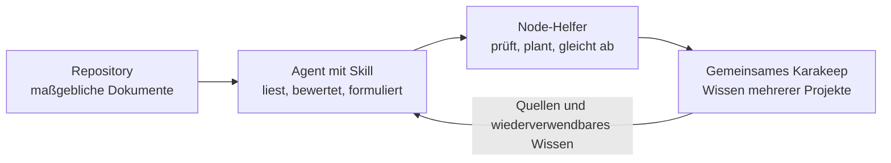
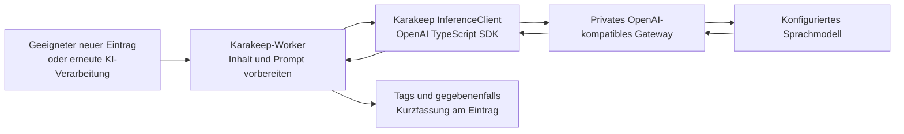

# Karakeep-Setup: Betrieb, Agentenwissen und native KI

**Stand: 16. Oktober 2026.** Dieser Bericht beschreibt das eingeführte lokale Setup,
die Ablageregeln und seine beobachteten Grenzen. Er ist die für Veröffentlichung
bereinigte Fassung des persönlichen Setup-Berichts. Endpunkte, Modellrouten,
Zugangsdatenverweise, lokale Pfade und identifizierende Betriebsdaten bleiben privat.

**Nächste Aktion:** Eine neue Agent-Sitzung in einem Repository beginnen. Die globale
Anweisung fordert die schreibgeschützte Startprüfung an. Für ein neues Projekt ist
einmalig eine konkrete Ablage-Policy nötig. Die nachfolgend genannten Tests sind
datierte Nachweise, keine erneute Prüfung der laufenden Installation.

## Zwei Abläufe im selben Setup

Beim Arbeiten wählt der Agent die Inhalte aus. Der Helfer speichert freigegebene
Dokumente, getrennte Entwürfe und kurze Faktenberichte, vermeidet Duplikate und
schützt manuelle Änderungen. Er arbeitet während eines Skill-Aufrufs. Dafür wurde
kein zusätzlicher Hintergrunddienst, n8n-Workflow oder Zeitplan eingerichtet.
Karakeeps bereits vorhandene Worker verarbeiten dagegen gespeicherte Inhalte.

Das eingeführte Setup nutzt einen bereits vorhandenen Modellzugang. Kosten und
Performance sind derzeit keine Auswahlhürden; relevante Grenzen sind Inhaltstreue,
Zuständigkeit und Wiederauffindbarkeit. An den Provider gelangen gespeicherter
Inhalt und die für den Prompt verwendeten Metadaten. Bei unterstützter Bildinferenz
können auch Bilddaten übertragen werden. Schlüssel und tatsächliche Gateway-
Konfiguration gehören in die private Laufzeitkonfiguration. Die ursprünglichen
Inhalte bleiben erhalten; Kurzfassungen können Details verlieren.

## Ablage und Aggregation

| Inhalt                         | Verbindliche Regel                                                                                                                           |
| ------------------------------ | -------------------------------------------------------------------------------------------------------------------------------------------- |
| Projektdokumente               | Das Repository bleibt maßgeblich und auch ohne Karakeep vollständig lesbar. Karakeep erhält zuordenbare Kopien.                              |
| Laufende Arbeit                | Entwürfe mit erkennbarem Arbeitsstand; sie ersetzen keine gültige Dokumentation.                                                             |
| Sessionwissen                  | Kurze Faktenberichte direkt innerhalb der freigegebenen Projekt-Policy; tatsächliche Arbeit und Prüfergebnisse nennen.                       |
| Übersichten                    | Eine sachliche Projektübersicht sowie bereits freigegebene Aggregate während relevanter Skill-Aufrufe pflegen.                               |
| Neue Erkenntnisse und Dossiers | Zuerst vorschlagen. Freigegebene allgemeine Dossiers können in Karakeep maßgeblich sein; Projekte übernehmen benötigte Inhalte ausdrücklich. |
| Projektzuordnung               | Eine private Projektliste je Projekt, wiederverwendbare Quellenobjekte sowie wenige klare Rollen-, Status- und Themenmerkmale.               |

Eine Linkliste allein erhält den fachlichen Inhalt nicht. Direkte fachliche Quellen
werden wiederverwendet oder mit ihrem Inhalt erfasst; fehlender Inhalt bleibt
sichtbar. Weiterführende Links werden nur bei Bedarf verfolgt. Aggregate verweisen
auf Originalquellen und deren Stand. Ein erneut importiertes Repository-Aggregat ist
als abgeleiteter Inhalt erkennbar und wird nicht erneut als unabhängige Originalquelle
verarbeitet. Originale bleiben für die Bewertung einer Zusammenfassung zugänglich.

Ausführliche verbindliche Regeln stehen in der
[gemeinsamen Spezifikation](specs/karakeep-agent-knowledge-spec.md); der
[Helper-Vertrag](../skills/engineering-workflows/karakeep-knowledge/references/helper.md)
erklärt Aufruf, Policy, Konflikte und Wiederaufnahme.

## Was nachgewiesen wurde und was offen bleibt

- **Lokale Einführung:** 25 Python- und 16 Node-Tests, unabhängige Vorwärtsprüfung,
  echte Speicherung und Rücklesen sowie unveränderte Wiederholung mit null
  Schreibaufrufen. Der damalige lokale Gesamtcheck, Formatierung und Lint bestanden.
  Die damaligen PR-Prüfungen waren erfolgreich. Details im
  [historischen Einführungsnachweis](../skill-evals/karakeep-knowledge/runs/2026-10-16-helper.md).
- **Startprüfung:** Eine frische Codex-Sitzung hat sie selbst aufgerufen. Eine strenge
  Lesesandbox kann den lokalen Zugriff sperren; Projektarbeit läuft dann weiter,
  ausstehende Wissensarbeit bleibt sichtbar.
- **Native KI:** Ein echter neuer Quellen-Link erhielt fünf KI-Tags und eine deutsche
  Kurzfassung. Dies belegt den Textpfad für diesen Eintrag, keinen repräsentativen
  Qualitätsvergleich. Bildinferenz wurde nicht separat qualifiziert.
- **Aktueller gemeinsamer Quellstand:** Skill 0.5.0 ergänzt die eingeführte Version um
  Review-Korrekturen und enthält den Hermes-Adapter. Die
  [Korrektur-Nachweise](../skill-evals/karakeep-knowledge/runs/2026-10-16-review-fixes.md)
  sind von der älteren lokalen Installation getrennt. Neue Versionen sind nicht
  allein durch einen PR bereits auf allen Hosts installiert.
- **Offen:** weitere Repositories im normalen Arbeitsfluss aufnehmen. Semantische
  Suche blieb im qualifizierten lokalen Setup aus, weil der verwendete Zugang kein
  Embedding-Modell bereitstellte. Volltextsuche funktionierte. Gehostete Hermes-
  Erreichbarkeit, Zugang und echte Session bleiben eigene Integrationsnachweise;
  siehe [Hermes-Adapter](../skills/engineering-workflows/karakeep-knowledge/references/hermes.md).

Es wurde kein Massenimport und kein KI-Massenlauf über bestehende Einträge gestartet.
Native Regeln sind verfügbar; zusätzliche Sortierregeln wurden nicht benötigt.
Die globale Anweisung ist ein Auftrag an den Agenten und garantiert kein lückenloses
Audit-Log. Rohprotokolle bleiben beim ausführenden Agenten beziehungsweise im
zuständigen geschützten Logging.

## Lohnt sich die interne KI?

**Empfehlung: native KI für die Grunderschließung behalten; den ausführenden Agenten
für projektbezogene Einordnung und belastbare Synthesen einsetzen.** Das ist eine
Empfehlung für dieses Setup, keine gemessene Überlegenheit eines Modells.

Die bisherige Einzelprobe zeigt, dass Tags und Kurzfassung technisch erzeugt werden.
Sie misst weder fachliche Genauigkeit noch Suchverbesserung über die ganze Sammlung.
Qualität hängt vom gewählten Modell, erfasstem Ausgangstext, Prompt, Sprache und
tatsächlich übergebenem Kontext ab. Ein leistungsfähiges Modell kann fehlende oder
abgeschnittene Quellen nicht ersetzen. [Quellen: Konfiguration und Prompts](#primärquellen).

| Ansatz             | Vorteile                                                                                                                                                 | Nachteile                                                                                                                                                                        |
| ------------------ | -------------------------------------------------------------------------------------------------------------------------------------------------------- | -------------------------------------------------------------------------------------------------------------------------------------------------------------------------------- |
| Karakeep-KI        | Verarbeitet geeignete Einträge auch aus Browser, Mobilgerät oder Import; arbeitet ohne aktive Coding-Sitzung; einheitliche Grund-Tags und Kurzfassungen. | Wenig Projekt- und Sessionkontext; eigener Inferenzlauf; begrenzter Promptkontext; je nach Inhaltstyp eingeschränkte Unterstützung.                                              |
| Ausführender Agent | Kennt Aufgabe, Projekt und Entscheidungen; kann Quellen vergleichen, Tags gezielt auswählen und eigene Dokumente gleich verständlich formulieren.        | Erfasst nur besuchte Inhalte während seiner Arbeit; benötigt Schreibrechte und tatsächlich unterstützte Felder; Umsetzung und konsequente Ausführung müssen sichergestellt sein. |
| Kombination        | Native Grunderschließung plus gezielte Projektzuordnung, Faktenberichte und geprüfte Aggregate.                                                          | Zuständigkeit für dieselben Felder muss klar sein, sonst entstehen doppelte oder überschreibende Zusammenfassungen.                                                              |

Der Agent kann Tags und Kurztexte selbst erzeugen. Der Upstream-MCP von v0.33.2
bietet sowohl das Aktualisieren des Summary-Felds als auch das Anhängen und Entfernen
von Tags; siehe [MCP-Schreiboperationen](https://github.com/karakeep-app/karakeep/blob/v0.33.2/apps/mcp/src/bookmarks.ts).
Das tatsächliche Toolangebot und die Rechte des verwendeten Clients müssen diese
Operationen ebenfalls erlauben. Generierter Text ist erst nach einer unterstützten,
autorisierten Schreiboperation gespeichert.
Der aktuelle Node-Helfer übernimmt semantische Formulierungen vom Agenten; daraus
folgt keine zusätzliche eingebaute Schreiboperation für jedes native KI-Feld.
Insbesondere sind ein eigener Text-/Notizinhalt und Karakeeps natives `summary`-Feld
unterschiedliche Ablageorte. Ein erneuter nativer Summary-Lauf setzt dieses Feld
neu. Agent und Worker sollten deshalb nicht ohne eindeutige Zuständigkeit dasselbe
Summary-Feld pflegen.

Für normale Quellen-Links bietet die native KI einen nützlichen unabhängigen
Grundservice. Bei bereits vom Agenten geschriebenen Sessionberichten genügt häufig
der gut strukturierte Bericht selbst; eine zweite Kurzfassung ist optional. Neue
Erkenntnisse, Bewertungen und Dossiers bleiben an die vereinbarten Freigaben gebunden.
Projektzuordnung und Dokumentstatus sollten aus verlässlichen Metadaten stammen;
freie KI-Thementags ersetzen diese Zuordnung nicht. Native Neuverschlagwortung
ersetzt die bisher KI-zugeordneten Tags und erhält menschlich zugeordnete Tags.
Per Agent-Werkzeug gesetzte Tags erhalten nicht automatisch dieselbe KI-Herkunft;
die Zuordnung muss nachvollziehbar bleiben.
[Tagging-Implementierung](https://github.com/karakeep-app/karakeep/blob/v0.33.2/apps/workers/workers/inference/tagging.ts).

## Technische LLM-Anbindung und Grenzen

Geprüfte Quellbasis: Karakeep **v0.33.2**. Karakeep verwendet für diesen Pfad einen
eigenen Job-/Worker-Ablauf mit Promptaufbereitung und einem `InferenceClient`.
Der OpenAI-Zweig ruft über das offizielle OpenAI-TypeScript-SDK
`chat.completions.create` auf. Das ist eine gezielte Inferenzpipeline; ein Coding-
Agent-Harness wie Codex oder Hermes ist dafür nicht erforderlich. Alternativ gibt
es einen nativen Ollama-Client. [Inference-Implementierung](https://github.com/karakeep-app/karakeep/blob/v0.33.2/packages/shared/inference.ts).

`OPENAI_BASE_URL` wählt den kompatiblen Endpunkt, `OPENAI_API_KEY` authentifiziert,
`INFERENCE_TEXT_MODEL` beziehungsweise `INFERENCE_IMAGE_MODEL` wählen die Modelle.
Ein vorhandenes LiteLLM-Gateway kann diesen API-Endpunkt bereitstellen und an das
gewünschte Modell routen. LiteLLM ist dabei die Gateway-Schicht; Karakeep besitzt
weiterhin seine eigenen Worker und Prompts. Kontext-/Ausgabelimits und das
strukturierte Antwortformat müssen zum gewählten Provider passen. Die Dokumentation
nennt für `INFERENCE_CONTEXT_LENGTH` standardmäßig 2048 Eingabetokens; die
Promptaufbereitung zieht ihren eigenen Platzbedarf ab und kürzt längere Inhalte.
Ein großes Modell-Kontextfenster wird dadurch nicht automatisch ausgenutzt. Dies
ist der dokumentierte Standard, keine neue Messung der privaten Konfiguration. Benutzerdefinierte
Prompts und Spracheinstellungen beeinflussen das Ergebnis.
[Provider-Konfiguration](https://docs.karakeep.app/configuration/different-ai-providers/).

**Wichtige Versionsgrenze:** Der geprüfte native Summary-Worker verarbeitet in
v0.33.2 tatsächlich Link-Einträge. Text- und Asset-Einträge werden dort übersprungen,
auch wenn eine Logmeldung mehr Inhaltstypen nahelegt. Eine allgemeine Aussage
„alles Gespeicherte bekommt eine native Kurzfassung“ wäre falsch. Die
[Summary-Implementierung](https://github.com/karakeep-app/karakeep/blob/v0.33.2/apps/workers/workers/inference/summarize.ts)
ist hier maßgeblich. Das ist ein zusätzlicher Grund, Agentenberichte bereits selbst
verständlich zu formulieren. Nach einem Karakeep-Upgrade ist die Grenze neu zu prüfen.

## Abschalten, Erhalt und Wiederaufnahme

Native KI-Tags und Kurzfassungen können in den persönlichen Karakeep-KI-Einstellungen
ausgeschaltet werden. Für Helper-Schreibabgleiche lässt sich die private Policy auf
`writeEnabled: false` setzen. Gespeichertes Wissen bleibt bestehen. Entfernte
Agent-Anweisungen allein widerrufen keine API-/MCP-Schreibrechte; ein erzwungener
Schreibstopp benötigt den zuständigen Credential-/Interface-Owner.

Zugangsdaten, Endpunkte, dauerhafte Daten, Assets und private Wiederaufnahmebelege
werden getrennt vom öffentlichen Skill-Quelltext verwaltet. Für Wiederherstellung
werden die tatsächlichen Service-, Datenbank-/Asset- und Konfigurationsnachweise
benötigt; ein Bookmark-Export allein ist kein vollständiger Sicherungsnachweis.
Die [Betriebsreferenz](../skills/engineering-workflows/karakeep-knowledge/references/operations.md)
beschreibt Erhalt und Wiederherstellung.

## Primärquellen

- [Karakeep v0.33.2: InferenceClient und OpenAI-/Ollama-Aufrufe](https://github.com/karakeep-app/karakeep/blob/v0.33.2/packages/shared/inference.ts)
- [Karakeep v0.33.2: Summary-Worker und gespeichertes Summary-Feld](https://github.com/karakeep-app/karakeep/blob/v0.33.2/apps/workers/workers/inference/summarize.ts)
- [Karakeep v0.33.2: Tagging und Herkunft](https://github.com/karakeep-app/karakeep/blob/v0.33.2/apps/workers/workers/inference/tagging.ts)
- [Karakeep v0.33.2: MCP-Lese- und Schreiboperationen](https://github.com/karakeep-app/karakeep/blob/v0.33.2/apps/mcp/src/bookmarks.ts)
- [Karakeep v0.33.2: Promptaufbereitung](https://github.com/karakeep-app/karakeep/blob/v0.33.2/packages/shared/prompts.server.ts)
- [Offizielle Provider-Konfiguration](https://docs.karakeep.app/configuration/different-ai-providers/)
- [Offizielle Umgebungsvariablen](https://docs.karakeep.app/configuration/environment-variables/)

Der Bericht verändert weder Servicekonfiguration noch Modellwahl oder Schreibrechte.
Seine Quellenprüfung ergänzt die datierten Einführungsnachweise; sie ist kein neuer
Live-Test der privaten Instanz.
