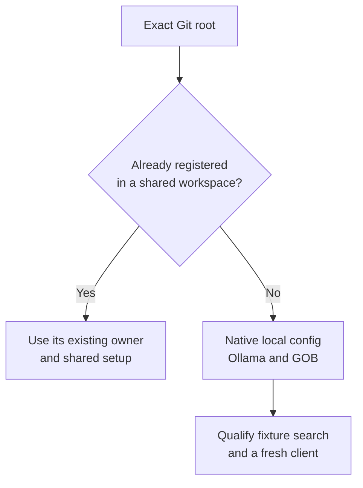

# Fresh standalone Linux setup

- This path works without Greppy, Qdrant, a sibling source checkout or personal dotfiles.
- Initial targets are NixOS/WSL2 and Ubuntu 24.04 x86-64. The candidate stays in the incubator until the full fresh-machine and fresh-client checks pass.

## Install through the host owner



- Linked worktree or ambiguous ownership: resolve the scope before setup; the helper refuses to guess.

- On NixOS, declare the GrepAI flake at revision `dd38459f31a8b25e49b886511a15667caf43478b` through the existing Nix owner.
- Its NAR hash is `sha256-PrTLLs3pX2pCdXeDnDQ6uYTT0SMvDX72stAGfPMT1Ug=`.
- Use Nix-managed Python with PyYAML and the existing Ollama service.
- Do not install another imperative copy over a declarative package.

- On Ubuntu, install Git, Python 3.12 with PyYAML and Ollama through the selected package/service owner.
- For the native GrepAI 1.1.0 x86-64 binary, download [`grepai_1.1.0_linux_amd64.tar.gz`](https://github.com/yoanbernabeu/grepai/releases/download/v1.1.0/grepai_1.1.0_linux_amd64.tar.gz) to a temporary directory.
- Its SHA-256 is `f95efe79687c686563e45fa5c6380195847aa7897c6ee3e1ab328d4b4f24fa30`, verified against upstream release metadata.
- Check before extracting and installing the executable in the adopted bin directory; inspect `grepai version` and `grepai init --help`.
- Never pipe a downloaded installer into a shell or overwrite another owner's executable.
- Pin the independently selected Ollama version too.

## Prepare and qualify one project

1. Inspect exact Git root, existing global workspace registrations, `.grepai`,
   `.grepaiignore`, nested repositories and symlinks. Use shared onboarding if an
   existing owner already registers this root. A linked worktree needs an explicit
   inheritance decision; the helper refuses to guess.
2. For a new configuration, run the bundled `scripts/standalone.py --repo ROOT`
   preview, then `--apply` within setup authority. Native initialization may
   update Git ignore files; review those changes. The helper preserves existing
   config and adds private/generated exclusions only to a new config. It starts
   neither a service nor indexing. GOB stores the index under the private `.grepai`.
3. Adopt local Ollama on loopback with `OLLAMA_NO_CLOUD=1`. Pull `bge-m3` only with
   model installation authority. Require `/api/tags` to report manifest digest
   `7907646426070047a77226ac3e684fbbe8410524f7b4a74d02837e43f2146bab` for that model;
   stop on a moved tag and review a new profile. An authorized `/api/embed` with
   `{"model":"bge-m3","input":"synthetic qualification"}` must produce one
   finite nonzero vector of length 1024. This is a model call, never doctor.
4. Add exclusions for nested/foreign roots. Native 1.1.0 can follow file symlinks;
   keep private material outside this root and exclude links before indexing.
   Index a disposable public fixture first. Within the authorized root run
   `grepai watch --no-ui` under its chosen process/service owner. Wait for initial
   scan and watch-loop evidence; record its owned PID/unit.
5. Run `grepai search --json -n 3 "fixture behavior"` from that exact root and
   verify source lines. Change then delete the fixture source and verify both
   propagate. Check ignored sentinels never enter the index. A query is allowed
   here as setup qualification; it can initialize state and is not a read-only
   diagnostic by default. Stop only the fixture's owned watcher when finished.

- Existing installations retain their provider/model/storage.
- Model changes require an explicit migration and recovery plan; do not edit a dimension just to hide an index mismatch.
- Never use the provider named `synthetic` as an offline test stub: it is a hosted provider, not a local fake.

## Codex CLI connection

- Merge the following through the existing client configuration owner, using the actual absolute executable and exact project paths:

```toml
[mcp_servers.grepai_project]
command = "/absolute/bin/grepai"
args = ["mcp-serve", "/absolute/project"]
```

- Use the selected server's project-scoped tools.
- Confirm actual skill discovery and tool calls in a fresh Codex CLI session.
- A declared MCP table is not evidence that the current session loaded it.
- Installation of this skill does not register MCP, index code, or enable any memory system.

## Evidence and recovery

- Record exact tool/model versions and roots, install result, retrieval, changes, deletions, exclusions, repeated setup and the client route separately.
- The bundled isolated lifecycle evaluation uses a loopback embedding stub; it proves index plumbing and source propagation, not real model quality or fresh-machine support.
- Keep real provider and Ubuntu installation evidence distinct.
- Preserve the old configuration/index until a migration is verified; stop the owned watcher before rollback and never delete another workspace's collection.

- Sources: [upstream initialization](https://github.com/yoanbernabeu/grepai/blob/dd38459f31a8b25e49b886511a15667caf43478b/cli/init.go), [MCP guidance](https://github.com/yoanbernabeu/grepai/blob/main/docs/src/content/docs/mcp.md).
- Installed 1.1.0 help confirms `--model`, `--backend gob` and the root argument to `mcp-serve`; newer main-branch documentation is not version qualification.
