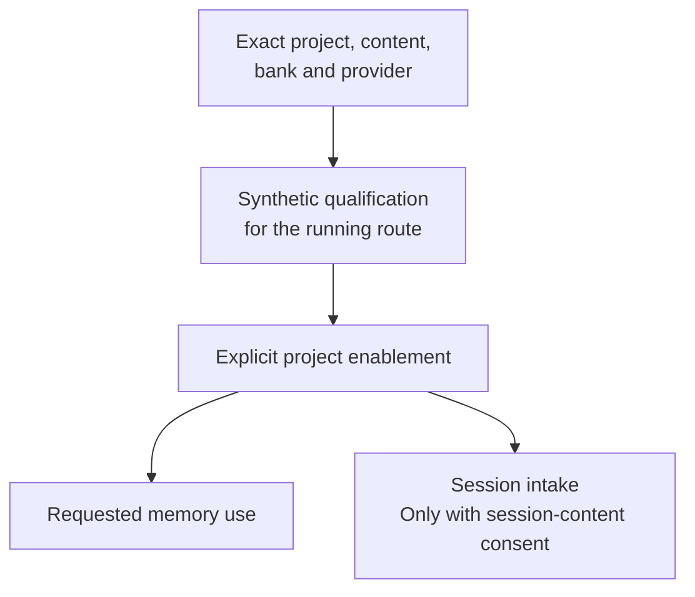

# Setup and qualification

## Contents

- [Workspace scope](#workspace-scope)
- [Existing single-project scope](#project-enablement)
- [Agent access and session automation](#agent-access-and-optional-session-automation)
- [Compact content and bounded intake](#compact-content-and-bounded-intake)
- [Acceptance and recovery](#acceptance-and-recovery)

- Use the host's existing package/service owner.
- On NixOS, package immutable helper artifacts and render service configuration declaratively.
- On standard Linux, use Python 3.11+, Docker Engine with Compose, and the pinned upstream image in `assets/compose.yaml`.
- No Greppy installation is required.
- Native Windows is outside the initial profile; use the Linux/WSL environment.

## Prepare without changing an existing installation

- Inspect ports 18888/19999, existing Compose projects, volumes and model services.
- Do not recreate or rename existing volumes.
- The template binds APIs to loopback and uses its own persistent storage.
- It disables raw document storage, content debug dumps and traces and mounts the private-storage validator read-only.

- Resolve `@COMPOSE_PROJECT@`, `@RUNTIME_ENV@`, `@POLICY@` and `@CODEX@` with reviewed absolute paths.
- `@CODEX@` is needed only for the optional existing Codex login provider.
- The provider remains a separate explicit choice; no personal gateway exception is included.
- Validate the rendered Compose file before starting it.

- Create settings in the selected private namespace.
- For example, when a local generative model has already been approved and installed:

```sh
python3 scripts/initialize.py --namespace hindsight-memory \
  --provider ollama --model APPROVED_GENERATIVE_MODEL --embedding-model bge-m3
```

- For an HTTPS gateway, choose `openai-responses`, its exact `--base-url`, model and owned mode-0600 `--key-file`.
- `--accepted-http-base-url` is only for a separately accepted exact route; it is not a recommended setup default.
- Initialization does not overwrite an existing configuration.
- Validate actual embedding output and dimensions before creating any bank/index.
- Do not change an existing collection's embedding model in place.

- The initializer and template are preparation tools.
- Starting the Compose service, creating accounts/banks and calling models require the corresponding setup scope.
- No model invocation is part of doctor.

## Workspace scope

Use one mode-0600 policy based on `assets/workspace.example.json` when the accepted
scope covers development roots or a group of repositories. The template is off
and contains placeholders. Installing it does not grant consent or activate intake.
Set `enabled: true` only after recording the accepted roots, exclusions, source
session roots, content scope and model route. `compact-session-outcomes` is the
workspace content mode. Search discovery alone is not enrollment authority.

- `roots` admits actively used exact Git roots; `exclude` removes paths/subtrees.
  Exclude reference clones and separately governed client repositories as needed.
- `sessionsRoots.codex` and `sessionsRoots.pi` limit each source independently.
  Codex automation accepts main interactive CLI sessions; headless/subagent clients
  must not emit eligible capture events. Pi ephemeral sessions skip capture.
- `repositories` contains sparse exact-root overrides, for example
  `"/absolute/dev/project": {"bankId": "existing-bank", "enabled": true}`.
  `enabled: false` pauses that repository inside the accepted maximum scope.
  This switch can be changed without requalifying unrelated repositories. Preserve
  a known existing bank through this override before enrolling it into the new scope.
- `worktrees` maps an exact linked-worktree root to its canonical repository root.
  Both must have the same Git common directory. An unmapped `.git`-file checkout is
  excluded, and a nested repository never inherits its parent's bank.
- First eligible use registers the exact repository in private
  `stateRoot/repositories.json`. The stored `repoId` and `bankId` are reused.
  Independent clones receive separate IDs. An origin URL does not prove identity.
- Reassociation after a move/reclone is explicit: use the saved `repoId` in the
  new root's override and review the change before requalification. Inode-preserving
  moves and replacement at a known root stop rather than silently creating a bank.
  Cross-filesystem moves cannot be identified reliably from Git paths alone; supply
  the override before using the new path. Do not repurpose an old bank for an
  unrelated clone.

Keep `stateRoot` outside all source roots. Reuse the existing runtime environment,
immutable image, embedding model/digest and privacy extension. Do not change an
embedding model in an existing bank as part of this migration.

```sh
python3 scripts/workspace_scope.py doctor --workspace-policy POLICY
python3 scripts/workspace_scope.py enable --workspace-policy POLICY --evidence EVIDENCE
python3 scripts/workspace_scope.py enable --workspace-policy POLICY --evidence EVIDENCE --apply
```

Doctor returns `bindingSha256` for the actual route, even before activation. Use the
same four synthetic checks and reviewed/privacy-accepted route evidence described
below. Record real results; an example is not qualification. Enable creates one
activation timestamp. The hook and worker conservatively skip sessions that began
before it, including resumed old sessions, so enrollment never backfills history.
New repositories inside an unchanged accepted scope need no separate interview.
Changing accepted roots, static exclusions, bank/repository/worktree mappings,
destinations or the remaining policy binding requires reviewed requalification.
Repository `enabled` flags and entries containing only that flag are omitted from
the route binding; they cannot widen the accepted roots or static exclusions.
Adding entries to the private runtime registry does not change the policy binding.

Use `workspace_scope.py disable --workspace-policy POLICY --apply` to remove the
activation marker, or set the workspace/repository off switch to stop new work.
Keep pending references and stored memories. Re-enabling with a new activation
cutoff does not make old pending sessions eligible. Review those separately; do not
discard them automatically.

## Project enablement



- Copy `assets/project.example.json` outside the repository, replace its placeholders and apply mode 0600. Each project gets an explicit bank and independent state root.
- Record actual consent; leaving the placeholder prevents enablement.
- `contentScope: manual-memory` permits only explicitly requested MCP use.
- Keep `codex-session-content` for an existing approved single-project grant.
  Intake now uses the compact reader for this compatibility mode too; it does not
  upload raw tool inputs/outputs.
- The hook and weekly job reject a manual-memory grant; free-text scope descriptions are not executable filters.
- Sessions can contain other projects' text, so review what is admitted.

- `scripts/project_scope.py doctor --policy POLICY` reports a fingerprint of the declared project policy, private environment, actual running container settings and the mounted privacy extension and helper payload.
- It reads Ollama model metadata, never an embedding or generation endpoint.
- Secret values are never printed.
- It refuses a different image, route, API port or writable/mismatched privacy mount.
- A container restart with identical effective settings does not by itself invalidate evidence.

- After running the real synthetic checks, write a private mode-0600 evidence file:

```json
{
  "schemaVersion": 1,
  "bindingSha256": "FINGERPRINT_FROM_THE_QUALIFIED_RUNNING_ROUTE",
  "modelRouteReviewed": true,
  "modelRoutePrivacyAccepted": false,
  "checks": {
    "retainReadback": true,
    "projectIsolation": true,
    "rawTextDisabled": true,
    "embeddingDimensions": true
  }
}
```

- This is an example, not a receipt.
- Do not copy its passes before measuring them.
- Privacy acceptance may replace route review only when that risk was explicitly accepted.
- Enablement records the evidence digest and current binding; later changes to either policy or the effective route stop new automated intake.

```sh
python3 scripts/project_scope.py enable --policy POLICY --evidence EVIDENCE
python3 scripts/project_scope.py enable --policy POLICY --evidence EVIDENCE --apply
python3 scripts/project_scope.py doctor --policy POLICY
```

## Agent access and optional session automation

- Use a bank-bound MCP endpoint through the existing proxy/client owner.
- The launcher reads the private key into the proxy environment rather than putting it in arguments:

```sh
python3 scripts/mcp_launcher.py RUNTIME_ENV MCP_PROXY --policy POLICY
```

- Compact session automation uses `session_parser.py`; no Node parser or extra
  model summarizer is needed. The pinned upstream parser assets and `--parser`
  argument remain available for installation compatibility.
- Mount the complete installed helper directory read-only for a worker; it imports
  the bundled reader. `weekly.py` supplies this mount and preserves the host UID/GID.

- Pass the explicit policy to `session_hook.py --policy POLICY` and `weekly.py --policy POLICY --docker DOCKER --compose COMPOSE --worker WORKER --parser PARSER`.
- Only new interactive CLI sessions rooted in that project are eligible.
- The worker retains the host UID/GID and mounts only the selected transcript read-only.
- Verify an actual trigger before describing the workflow as unattended.

For workspace scope replace `--policy` with `--workspace-policy` in each command.
The MCP launcher reads the workspace's `runtimeEnv`; its positional runtime argument
is used only by the legacy/project interface. The launcher's working directory must
be the current repository. A connection is bound to that bank at startup. Reconnect
after switching repositories, narrowing a grant, changing the route or disabling
memory; an already-running MCP proxy cannot revalidate each call. A session capture
off switch does not revoke an existing MCP connection.

Use the client's existing MCP mechanism. Pi 1.5.2 supports native MCP; a separate
retrieval gateway or tool-routing agent is unnecessary. Preserve unrelated tools,
hooks and model settings. Codex hook trust remains a separate native requirement.

Hook payloads use `hook_event_name: Stop` for a provisional completed-turn checkpoint
and `SessionEnd` for final shutdown, plus `source: codex|pi`, `session_id`, `cwd` and
`transcript_path`. Pi also supplies `leaf_id` and, when known,
`completion_status: complete|aborted`. Use pi `agent_settled`, not `agent_end`, for
the completion checkpoint; the latter may still be followed by automatic work.
Codex Stop always receives `{}` on stdout and never requests continuation.
`HINDSIGHT_MEMORY_DISABLED=1`, `memory_disabled: true`, or `is_subagent: true`
suppresses capture. Skip pi noninteractive child clients in the host adapter.
Missing, disabled or invalid explicit policies never fall back to the pilot path.

The hook reads only local consent, activation time, transcript header and exact Git
identity. Registry/queue locks are nonblocking. It neither invokes Docker nor reads
model metadata. The worker checks the full effective route immediately before each
outbound dispatch, including after a policy change during a running batch.

- Ordinary project subdirectories are eligible; nested Git repositories, submodules and linked worktrees need their own project policy.
- The hook, queued-record validation and policy-bound MCP launcher use the same repository-boundary check.
- Before each worker dispatch, the batch rereads its private policy and checks the activation timestamp.
- Disabling/narrowing consent, changing the destination or re-enabling a grant stops that batch and preserves pending records.
- A request already dispatched may finish.
- MCP scope is checked when its transport starts; close and reconnect a running client after changing its grant.

| Root or consent change                                          | Effect                                                                      |
| --------------------------------------------------------------- | --------------------------------------------------------------------------- |
| Ordinary subdirectory                                           | Covered by the applicable parent project grant                              |
| Nested repository, submodule or linked worktree                 | Requires its own project policy                                             |
| Separately granted child repository                             | Eligible under its own grant                                                |
| Disabled/narrowed consent, changed destination or renewed grant | Current batch stops before its next worker dispatch; pending records remain |
| Already-dispatched operation                                    | May finish                                                                  |
| Running MCP transport                                           | Reconnect after changing its grant                                          |

## Compact content and bounded intake

The Python reader supports Codex CLI JSONL and pi 1.5.2 session version 3. It
retains the relevant user request and completed final assistant outcomes, with
source/session identity, timestamp and pi entry IDs. System/developer messages,
reasoning, commentary, tool inputs/outputs, injected recall blocks and compaction
summaries are excluded. Pi traversal follows the supplied leaf and applies native
context edits/retractions. Fork entries older than the new session header are
excluded; fork provenance is retained and is not counted as independent recurrence
evidence. Corrections do not automatically delete memories imported earlier.

These are agent-reported observations, not independently verified facts. Final
answers carry useful decisions, fixes, failure reports and source references without
an additional summarization model. A final longer than 6,000 characters becomes a
clearly marked excerpt at a text boundary, with an original-text hash. Consult the
original session for omitted details. Each dispatch admits at most 16 unseen
outcomes and 24,000 serialized content characters from a transcript of at most
32 MiB. Raw secret-pattern rejection, private raw-text enforcement, synchronous
retain and nonempty document readback remain required.

Outcome IDs include source, session and content identity. Known IDs are removed
before budgeting, and oldest unseen outcomes are processed first. Partial batches
remain queued for the next run. A queue file is a dirty reference: the worker reads
the latest complete JSONL prefix, bounded by the hook's `checkpoint_at` timestamp.
Only entries timestamped at or before that checkpoint are eligible; undated scoped
outcomes and future context edits are excluded. This admits delayed flushes whose
native event timestamps predate the hook, without admitting subsequent turns after
capture is paused. A pause preserves earlier queued work and stored memories. A
later enabled checkpoint can admit newer outcomes in the same eligible session,
including turns completed during the pause; it is a capture switch, not deletion
or a permanent exclusion interval.

An incomplete last line, a later append or a newer queue update keeps the record
pending. Pi's explicit leaf still selects the branch. The ledger records checkpoint,
leaf and completion status alongside the transcript digest so a later checkpoint
can admit eligible outcomes even if its transcript bytes are unchanged. These rules
reduce shutdown-flush races; forced termination without any checkpoint is not
guaranteed capture and needs actual client lifecycle qualification.

```sh
python3 scripts/weekly.py --workspace-policy POLICY --mode intake \
  --max-sessions 8 --max-seconds 240 \
  --docker DOCKER --compose COMPOSE --worker WORKER

python3 scripts/weekly.py --workspace-policy POLICY --mode weekly \
  --max-sessions 8 --max-seconds 1800 \
  --docker DOCKER --compose COMPOSE --worker WORKER
```

Run intake through the existing host scheduler, for example every five minutes
while the host runs. It never calls reflection. Keep weekly reflection separate.
Each batch is bounded by session count and elapsed time; one session may need
multiple runs. Status reports retained outcomes, empty/no-new-outcome checkpoints,
unchanged sessions and pending failures separately. An empty checkpoint makes no
model call and is not proof of successful extraction. Zero-fact extraction remains
a failure and preserves its queue record. Pending/revoked records block weekly
reflection rather than produce a falsely complete report.

A timed-out Docker worker is removed using its exact unique generated container
name. If that cleanup cannot be confirmed, the private
`worker-cleanup-required.json` marker stops future batches. Inspect/stop only that
named task-owned container through the existing host owner, then remove the marker
after verification. An already-dispatched API/provider operation may still finish.
Never retry by starting a second stack. Metadata named `commit_at_intake` and
`branch_at_intake` describes the later intake observation, not the revision at which
the source outcome happened; actual outcome revisions belong in its source text.

## Acceptance and recovery

- Qualify each selected provider/image on a disposable bank with synthetic data: successful synchronous extraction with nonempty IDs and readback, exact project scope, private raw-text storage, embedding dimensions, secret rejection, restart, repeat setup and a fresh client session.
- A result payload containing `status: error` is a failure even if the MCP error flag is absent.
- Report source and runtime proof separately.
- Do not claim a fresh installation from unit mocks.

- Use `disable --policy POLICY --apply` to stop future intake without deleting memories or pending queue entries.
- Preserve original package/service references and database volumes for rollback.
- Do not downgrade a migrated database implicitly.
- Review raw transcripts before admitting them: pattern-based secret rejection is useful but cannot guarantee detection of every credential format.

- Sources: [upstream Hindsight](https://github.com/vectorize-io/hindsight), its pinned 1.2.1 coding-agent parser and configuration interfaces.
- Upstream main documentation does not establish compatibility for another image version.

## Embedding and generative model identity

- New project grants currently qualify Ollama-backed embeddings only.
- Set `embeddingDigest` to the approved model manifest; the example pins BGE-M3. With a local generative provider also set `generativeDigest` and use the same Ollama instance.
- The helper compares `/api/tags` before every outbound worker invocation, so changing a model behind the same tag stops intake.
- Embedded BGE-M3 remains a legacy fallback and needs separate project-policy qualification before new enablement.
