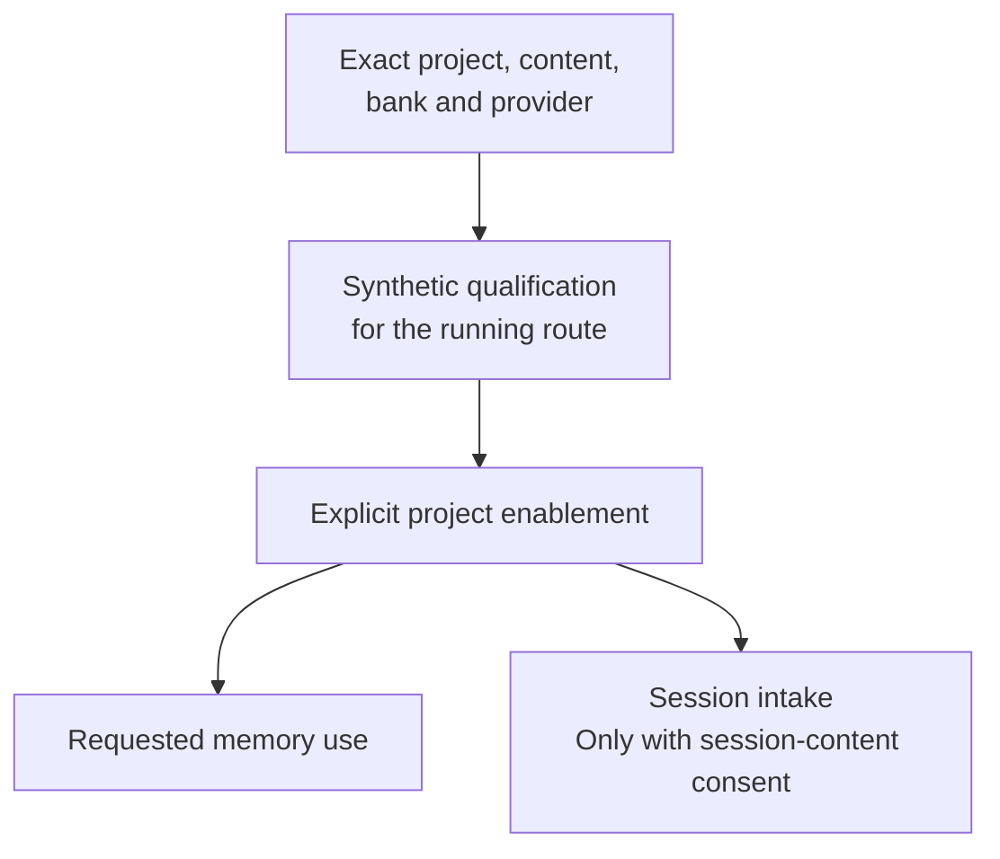

# Setup and qualification

- Use the host's existing package/service owner.
- On NixOS, package immutable helper artifacts and render service configuration declaratively.
- On standard Linux, use Python 3.11+, Docker Engine with Compose, and the pinned upstream image in `assets/compose.yaml`.
- No Greppy installation is required.
- Native Windows is outside the initial profile; use the Linux/WSL environment.

## Prepare without changing an existing installation

- Inspect ports 18888/19999, existing Compose projects, volumes and model services.
- Do not recreate or rename existing volumes.
- The template binds APIs to loopback and uses its own persistent storage.
- It disables raw document storage, content debug dumps and traces and mounts the private-storage validator read-only.

- Resolve `@COMPOSE_PROJECT@`, `@RUNTIME_ENV@`, `@POLICY@` and `@CODEX@` with reviewed absolute paths.
- `@CODEX@` is needed only for the optional existing Codex login provider.
- The provider remains a separate explicit choice; no personal gateway exception is included.
- Validate the rendered Compose file before starting it.

- Create settings in the selected private namespace.
- For example, when a local generative model has already been approved and installed:

```sh
python3 scripts/initialize.py --namespace hindsight-memory \
  --provider ollama --model APPROVED_GENERATIVE_MODEL --embedding-model bge-m3
```

- For an HTTPS gateway, choose `openai-responses`, its exact `--base-url`, model and owned mode-0600 `--key-file`.
- `--accepted-http-base-url` is only for a separately accepted exact route; it is not a recommended setup default.
- Initialization does not overwrite an existing configuration.
- Validate actual embedding output and dimensions before creating any bank/index.
- Do not change an existing collection's embedding model in place.

- The initializer and template are preparation tools.
- Starting the Compose service, creating accounts/banks and calling models require the corresponding setup scope.
- No model invocation is part of doctor.

## Project enablement



- Copy `assets/project.example.json` outside the repository, replace its placeholders and apply mode 0600. Each project gets an explicit bank and independent state root.
- Record actual consent; leaving the placeholder prevents enablement.
- `contentScope: manual-memory` permits only explicitly requested MCP use.
- Choose `codex-session-content` only when processing new eligible session messages and tool inputs/outputs is approved for this project and provider.
- The hook and weekly job reject a manual-memory grant; free-text scope descriptions are not executable filters.
- Sessions can contain other projects' text, so review what is admitted.

- `scripts/project_scope.py doctor --policy POLICY` reports a fingerprint of the declared project policy, private environment, actual running container settings and the mounted privacy extension and helper payload.
- It reads Ollama model metadata, never an embedding or generation endpoint.
- Secret values are never printed.
- It refuses a different image, route, API port or writable/mismatched privacy mount.
- A container restart with identical effective settings does not by itself invalidate evidence.

- After running the real synthetic checks, write a private mode-0600 evidence file:

```json
{
  "schemaVersion": 1,
  "bindingSha256": "FINGERPRINT_FROM_THE_QUALIFIED_RUNNING_ROUTE",
  "modelRouteReviewed": true,
  "modelRoutePrivacyAccepted": false,
  "checks": {
    "retainReadback": true,
    "projectIsolation": true,
    "rawTextDisabled": true,
    "embeddingDimensions": true
  }
}
```

- This is an example, not a receipt.
- Do not copy its passes before measuring them.
- Privacy acceptance may replace route review only when that risk was explicitly accepted.
- Enablement records the evidence digest and current binding; later changes to either policy or the effective route stop new automated intake.

```sh
python3 scripts/project_scope.py enable --policy POLICY --evidence EVIDENCE
python3 scripts/project_scope.py enable --policy POLICY --evidence EVIDENCE --apply
python3 scripts/project_scope.py doctor --policy POLICY
```

## Agent access and optional session automation

- Use a bank-bound MCP endpoint through the existing proxy/client owner.
- The launcher reads the private key into the proxy environment rather than putting it in arguments:

```sh
python3 scripts/mcp_launcher.py RUNTIME_ENV MCP_PROXY --policy POLICY
```

- Session automation additionally needs the pinned upstream Codex transcript parser.
- `assets/parser.nix` builds the reviewed 1.2.1 parser for Nix.
- On standard Linux, install esbuild through the package owner, then use `scripts/build_parser.py --output /absolute/new/parser.cjs --esbuild /absolute/esbuild` to preview the three pinned downloads and build.
- Add `--apply` only within setup authority.
- Every downloaded source is checked against the same SHA-256 as the Nix build.
- Qualify the resulting parser artifact; do not substitute a newer parser silently.
- Manual bank-bound MCP use is independent of that optional parser.

- Pass the explicit policy to `session_hook.py --policy POLICY` and `weekly.py --policy POLICY --docker DOCKER --compose COMPOSE --worker WORKER --parser PARSER`.
- Only new interactive CLI sessions rooted in that project are eligible.
- The worker retains the host UID/GID and mounts only the selected transcript read-only.
- Verify an actual trigger before describing the workflow as unattended.

- Ordinary project subdirectories are eligible; nested Git repositories, submodules and linked worktrees need their own project policy.
- The hook, queued-record validation and policy-bound MCP launcher use the same repository-boundary check.
- Before each worker dispatch, the batch rereads its private policy and checks the activation timestamp.
- Disabling/narrowing consent, changing the destination or re-enabling a grant stops that batch and preserves pending records.
- A request already dispatched may finish.
- MCP scope is checked when its transport starts; close and reconnect a running client after changing its grant.

| Root or consent change | Effect |
| --- | --- |
| Ordinary subdirectory | Covered by the applicable parent project grant |
| Nested repository, submodule or linked worktree | Requires its own project policy |
| Separately granted child repository | Eligible under its own grant |
| Disabled/narrowed consent, changed destination or renewed grant | Current batch stops before its next worker dispatch; pending records remain |
| Already-dispatched operation | May finish |
| Running MCP transport | Reconnect after changing its grant |

## Acceptance and recovery

- Qualify each selected provider/image on a disposable bank with synthetic data: successful synchronous extraction with nonempty IDs and readback, exact project scope, private raw-text storage, embedding dimensions, secret rejection, restart, repeat setup and a fresh client session.
- A result payload containing `status: error` is a failure even if the MCP error flag is absent.
- Report source and runtime proof separately.
- Do not claim a fresh installation from unit mocks.

- Use `disable --policy POLICY --apply` to stop future intake without deleting memories or pending queue entries.
- Preserve original package/service references and database volumes for rollback.
- Do not downgrade a migrated database implicitly.
- Review raw transcripts before admitting them: pattern-based secret rejection is useful but cannot guarantee detection of every credential format.

- Sources: [upstream Hindsight](https://github.com/vectorize-io/hindsight), its pinned 1.2.1 coding-agent parser and configuration interfaces.
- Upstream main documentation does not establish compatibility for another image version.

## Embedding and generative model identity

- New project grants currently qualify Ollama-backed embeddings only.
- Set `embeddingDigest` to the approved model manifest; the example pins BGE-M3. With a local generative provider also set `generativeDigest` and use the same Ollama instance.
- The helper compares `/api/tags` before every outbound worker invocation, so changing a model behind the same tag stops intake.
- Embedded BGE-M3 remains a legacy fallback and needs separate project-policy qualification before new enablement.
