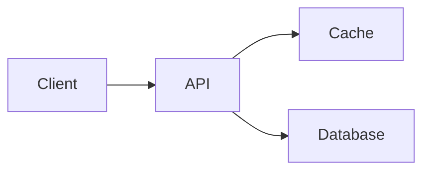

::::report{id="release-review" type="review" profile="code" style="balanced"}
# Release-Review · fiktives Beispiel

::takeaway[Die Änderung senkt die Latenz; der Speicherbedarf bleibt über dem Ziel.]
::next[Speicherverhalten unter längerer Last prüfen.]
::caveat[Alle Werte sind fiktive Demonstrationsdaten, keine Produktmessungen.]
::source{id="fixture" label="Demonstrationsdaten" state="fictional" asOf="2026-10-20"}

:::bullets{id="summary" title="Auf einen Blick" sources="fixture" icon="check"}
- Latenz fällt von 240 auf 150 ms.
- Speicherbedarf liegt 20 % über dem Ziel.
- Abnahme nach längerer Lastprüfung.
:::

:::chart{id="latency" title="Vorher / Nachher" type="before-after" unit="ms" context="p95-Latenz im fiktiven Test" direction="lower" series="before:Vorher,after:Nachher" sources="fixture" icon="git-compare"}
| id | label | series | value | state | sources | note |
| --- | --- | --- | --- | --- | --- | --- |
| api | API | before | 240 | fictional | fixture | gleicher Test |
| api | API | after | 150 | fictional | fixture | gleicher Test |
:::

:::chart{id="capacity" title="Ist / Ziel" type="actual-target" unit="MiB" context="Speicher im fiktiven Test" direction="lower" series="actual:Ist,target:Ziel" sources="fixture"}
| id | label | series | value | state | sources | note |
| --- | --- | --- | --- | --- | --- | --- |
| memory | Speicher | actual | 600 | fictional | fixture | gemittelte Last |
| memory | Speicher | target | 500 | fictional | fixture | geplante Grenze |
:::

:::chart{id="cost" title="Beiträge zum Endwert" type="waterfall" unit="EUR / Monat" context="Fiktive Betriebskosten" direction="lower" series="cost:Kosten" sources="fixture" icon="wallet"}
| id | label | series | value | state | sources | note | role |
| --- | --- | --- | --- | --- | --- | --- | --- |
| base | Ausgang | cost | 1000 | fictional | fixture | Ausgangswert | start |
| cache | Cache | cost | -180 | fictional | fixture | Einsparung | delta |
| logs | Logs | cost | 60 | fictional | fixture | zusätzliche Kosten | delta |
| total | Ergebnis | cost | 880 | fictional | fixture | Endwert | total |
:::

:::diagram{id="flow" title="Datenfluss" description="Der Client ruft die API auf; diese liest den Cache oder die Datenbank." sources="fixture" icon="layers"}

:::

:::timeline{id="schedule" title="Überlappende Arbeiten" sources="fixture" icon="clock"}
| id | label | owner | start | end | progress | dependsOn |
| --- | --- | --- | --- | --- | --- | --- |
| build | Umsetzung | Team A | 2026-10-20 | 2026-10-23 | 80 | |
| review | Review | Team B | 2026-10-22 | 2026-10-24 | 30 | build |
| accept | Abnahme | Team A | 2026-10-24 | 2026-10-24 | 0 | review |
:::

:::statusHistory{id="observations" title="Statusverlauf" context="Vier ungleich verteilte Stichproben, keine Verfügbarkeitsmessung" sources="fixture" icon="activity"}
| at | status | sources | note |
| --- | --- | --- | --- |
| 2026-10-20T08:00:00Z | healthy | fixture | Antwort normal |
| 2026-10-20T08:01:00Z | degraded | fixture | Antwort langsam |
| 2026-10-20T08:05:00Z | down | fixture | Keine Antwort |
| 2026-10-20T10:00:00Z | unknown | fixture | Keine Beobachtung |
:::
::::
